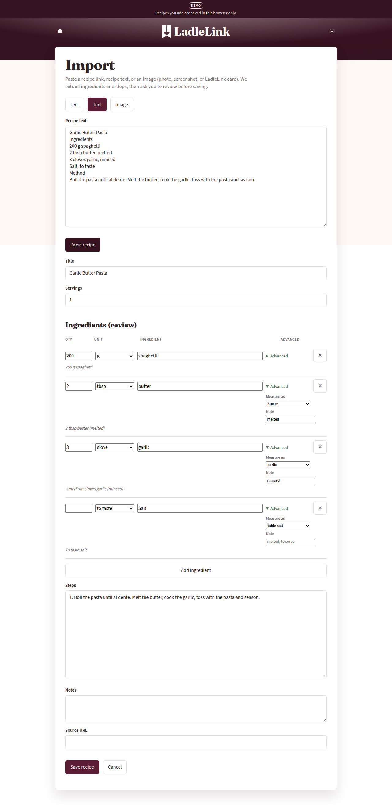
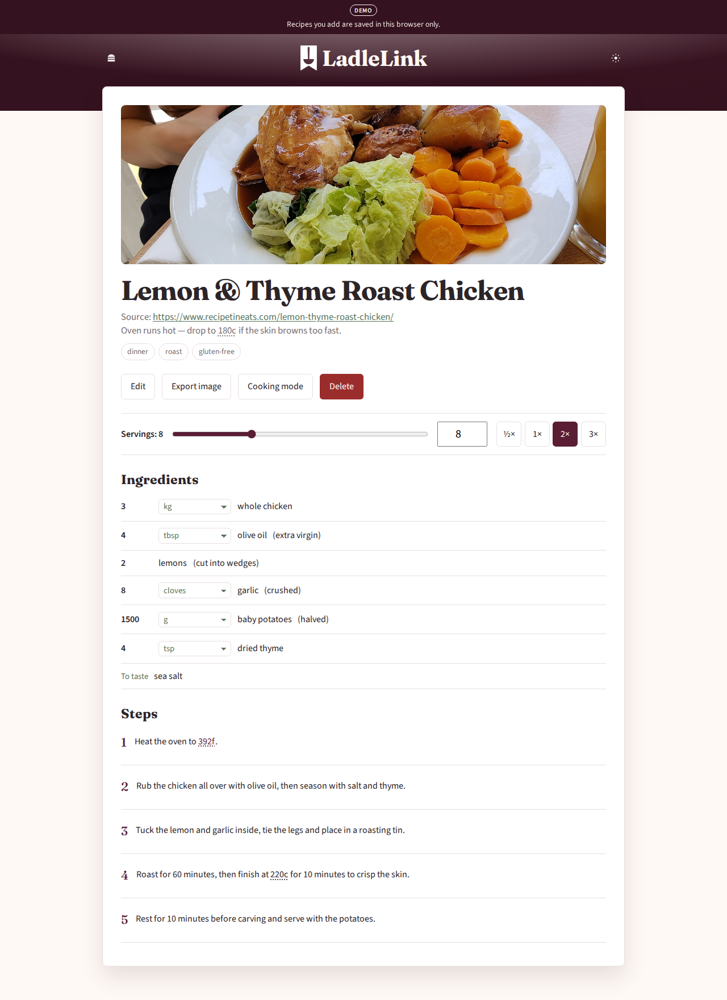
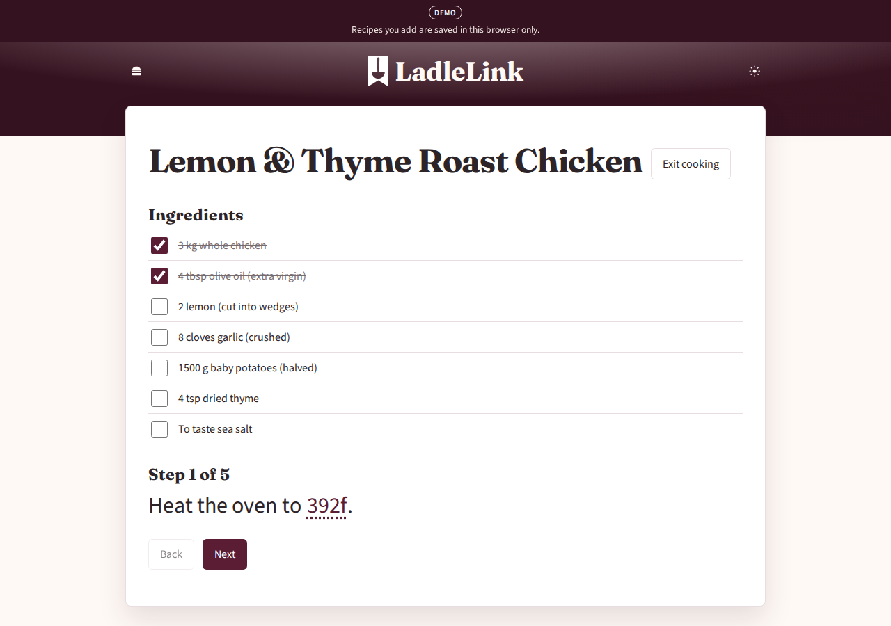

# LadleLink

**Self-hosted recipe manager that scales with you.**

Try it at **<https://danaleetech.github.io/LadleLink/>** — nothing to install. The demo keeps your recipes in your browser only.

LadleLink is a local-first recipe manager you run yourself — one Docker container, a SQLite file you own. Save a recipe, drag the serving slider, and every ingredient re-scales live, with unit conversions that respect what you're measuring:

1. **Portion scaling.** One slider (or the ½× / 1× / 2× / 3× buttons) keeps every ingredient in step.
2. **Density-aware unit conversion.** Cups ⇄ grams ⇄ ml with a per-ingredient density table, so a cup of flour and a cup of water both convert correctly. Cup size is metric 250 ml by default; US 240 ml is a setting. Any ingredient's unit can be switched in the reader.
3. **Import your way.** Paste a recipe URL (structured data, microdata and a plain-text fallback tried in order), paste the recipe text, or pick up to five photos or screenshots and let the OCR do it. The review step shows every photo the page offered so you can keep the right one.
4. **Tappable temperatures.** Write `200c` or `400F` in a step or note and the reader turns it into a one-tap C ⇄ F converter. A setting adds Kelvin.
5. **Cooking mode.** Full-screen, one step at a time, with tickable ingredients and the screen kept awake.
6. **Photos your way.** Keep the page's photo, pick a different one at review, upload your own from the editor, or remove it. A recipe with no photo simply shows none.
7. **Everything else.** Tags, notes, source links, search, undo delete, a recipe-card image export, dark mode, and JSON backup/import.

## Screenshots

One recipe through the app — imported, reviewed, scaled, cooked.







## Your recipes stay on your machine

Self-host it and everything — the SQLite database and photos — lives in a folder on your machine. There is no account and no cloud service. It runs anywhere Docker does: a home server, NAS, or Raspberry Pi.

The public demo is the same app built with browser-only storage: recipes live in that visitor's browser (IndexedDB), and the demo stores nothing.

## Run your own copy (Docker)

Docker only — no Node needed:

```sh
docker run -d --name ladlelink -p 8080:8080 -v "$PWD/data:/data" \
  ghcr.io/danaleetech/ladlelink:latest
```

Then open <http://localhost:8080>.

Or clone and use compose (adds `.env` handling):

```sh
git clone https://github.com/DanaLeeTech/LadleLink.git
cd LadleLink
cp .env.example .env          # optional AUTH_TOKEN
docker compose up -d --build
```

Set a strong `AUTH_TOKEN` in `.env` before exposing it beyond your own machine.

| Variable     | Default  | Notes                                       |
| ------------ | -------- | ------------------------------------------- |
| `PORT`       | `8080`   | Server port                                 |
| `DATA_DIR`   | `./data` | SQLite + photos (in the container: `/data`) |
| `AUTH_TOKEN` | unset    | If set, require `Authorization: Bearer …`   |

## Import

Import is user-initiated. On your own instance the server fetches the page behind a guard (private-network block, size and time caps, HTML only, optional ClamAV scan). In the demo the page is fetched through public reader services from your browser and parsed locally. Pasting the recipe text or uploading photos/screenshots works without relying on the recipe site (the OCR model downloads and caches on first use).

The review step lists every photo found on the page (the same photo in several crops or sizes appears once). Pick one, leave it out, or upload a photo of your own instead. Uploaded photos are shrunk in the browser, stored in `data/photos`, and capped at 8 MB each; the folder is capped at 500 MB. Replacing or removing a photo deletes the old file, and a startup sweep clears anything left behind by an abandoned review.

The public demo keeps no photos at all, including the ones a page offers.

## Photos

The editor has the same picker: upload, replace or remove a recipe's photo. A recipe without a photo shows no placeholder — the reader simply starts with the title.

## Temperatures

Write temperatures in a step or note as a number plus `c`, `f` or `k` — `200c`, `400F`, `200 °C`, a range like `180–200C`, or `300K`. In the reader they become tappable: one tap converts (C ⇄ F, or C → F → K when the Kelvin option is on in Settings), and tapping again returns to how you wrote it. The ⓘ next to the editor's Steps and Notes labels has the formats.

## Local development

Requires Node 20+.

```sh
npm install
npm test
npm run build
npm run dev          # API http://127.0.0.1:8080, Vite UI http://127.0.0.1:5173
```

The demo build is the same UI with browser storage:

```sh
npm run build:demo -w @ladlelink/web
```

## Android

An Android app (Capacitor) is in development and will be released later.

## Known limits

- Some recipe sites block the public import readers, so URL import can fail there. Pasting the recipe text or importing images still works. A self-hosted instance fetches pages itself, but a site may still refuse bots.
- Temperature conversion understands `200c` / `400F` / `300K` style text; gas mark ("gas mark 6") is not converted.
- The Android app is in development and not released.
- JSON backup/export does not include uploaded photo files; back up the `data` folder (the whole data directory) to keep them. Photos saved as web addresses are just links.
- The demo keeps no photos, and its recipes never leave the visitor's browser.

## Layout

| Path                 | Role                                                                   |
| -------------------- | ---------------------------------------------------------------------- |
| `apps/server`        | Express + SQLite API                                                   |
| `apps/web`           | React UI (full app and demo builds)                                    |
| `apps/mobile`        | Capacitor shell (in development)                                       |
| `packages/`          | shared TypeScript: types, units, scaling, parser, url-guard, ll-bridge |
| `docker-compose.yml` | self-host stack                                                        |

MIT licensed.
